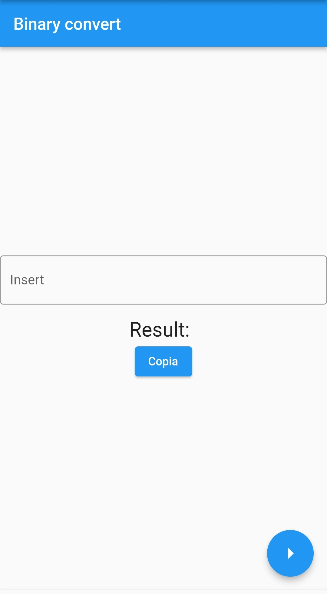
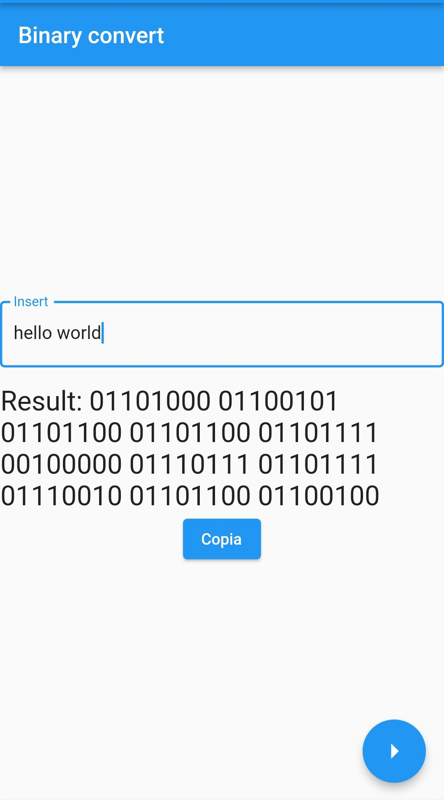

# Binary Translator

A small Flutter app that translates text to binary and binary back to text.

- **Text → Binary**: every character is encoded as UTF-8, one 8-bit group per byte
  (so accented letters and emoji work too: `è` → `11000011 10101000`).
- **Binary → Text**: paste space-separated 8-bit groups to get the text back.
- Switching direction feeds the current result back as input, so you can check the round trip.

## Download

Every push to `main` builds a release APK and publishes it on the
[Releases page](../../releases) (tag `v<version>-build.<run>`).
The version name comes from `pubspec.yaml`.

## Development

```bash
flutter pub get
flutter test
flutter run
```

## Screenshots

 
